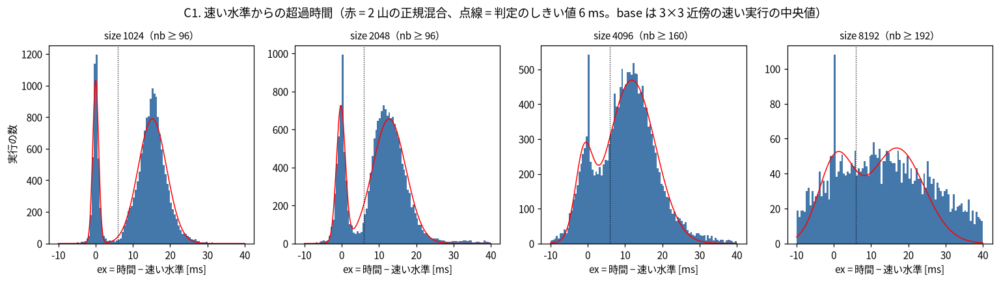
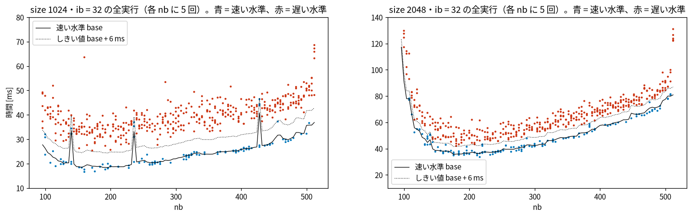
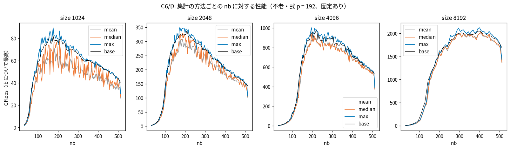

# 不老・弐の本番スイープ（size 1024〜8192、p = 192）の検証

作成：2026-11-10。依頼：Vault の `chats/2026-11-10_flow2-sweep-verification-request.md`。
対象：`~/Download/flow/benchmark/` の本番 15 ジョブ（CSV 20 本）と動作確認の r0。元のデータは読んだだけで、変更していない。
数値はすべて `scripts/` の出力（`data/*.csv`、実行時の表示は `data/log_*.txt`）から取った。

## 1. 結論

| size | 判定 | 理由 |
|---|---|---|
| 8192 | 使える | 欠測なし、条件どおり。集計の方法を変えても最適 nb は 400〜408、値の差は 5% 以内 |
| 4096 | 使える（値は集計の方法を明記） | 最適 nb は 196〜220 で安定。値は方法で 892〜1003 GFlops（12%）動く |
| 2048 | 条件付き | 最適 nb は 172〜208。値は方法で 308〜348 GFlops（13%）動く。遅れが入ると性能は約 7 割になる |
| 1024 | 条件付き | 最適 nb は 176〜208。値は方法で 71〜90 GFlops（26%）動く。遅い水準は速い水準のほぼ半分の性能 |

- **データそのものに欠陥はない。** 全 64,555 点が格子どおりで、欠測・重複・0 はなく、検算は全点で通っている。15 ジョブの条件、スレッドの固定、ノードの構成はそろっている。特定のノードだけ速い・遅いこともない
- **2つの水準は実在する。** 1回の実行に、約 13〜15 ms の一定の時間が、約 4 回に 3 回の割合で足される。nb・ib・size・ノード・実行順によらず、同じ点の 5 回にもほぼ独立に入る。原因は分かっていない
- **集計は「点ごとの最小時間（最大 GFlops）を、(nb, ib) の近傍でならしたもの」を使う**（この報告の base）。最適点は1点ではなく「最適から 5% 以内の範囲」で示す。5 回の平均は使わない（2つの水準が混ざった値になる）
- 値を言うときは「速い水準」と「ふつうに出る水準（中央値）」の両方を示す。どちらがほかの機種と比べるべき値かは、まだ決められない

## 2. 検証の結果

### A. データが揃っていて、条件どおりか

`scripts/a_integrity.py` → `data/a1_grid.csv`、`a3_meta.csv`、`a4_affinity.csv`、`a5_snapshot.csv`

**A1. 格子**（本番 20 本と r0）

| 項目 | 結果 |
|---|---|
| 行数 | size 1024・2048・4096 は各 3963、8192 は各 1022、r0 は 9。期待と一致 |
| (nb, ib) の集合 | 20 本とも期待の集合と完全に一致。欠測 0、余分 0、重複 0 |
| 範囲と刻み | nb 32〜512、ib 8〜nb/2。刻みは size ≤ 4096 で 4、8192 で 8 |
| 行の順 | 20 本とも `plasma_perf/core/sweep.py` の実行順（nb の昇順、その中で ib の昇順）と一致 |
| 値 | NaN 0、0 以下 0。最小 1.62 GFlops（size 1024、nb 32）、最大 2124 GFlops（size 8192） |
| `threads`、`size` | 全行が 192 と、ファイル名の size に一致 |
| 改行、列 | CRLF、`threads,size,nb,ib,GFlops` |

**A2. 欠測の記録のしかた**（plasma-bench `7d865e3` のコード）

- `benchmarks/tileqr/runner.py`：終了コードが 0 でない、または出力に `pass <誤差> <時間> <GFlops>` の行がないと、GFlops を **0.0** と書く。行は落とさない
- タイムアウトは設定されていない（`estimate_timeout` が `None` を返す）
- `--test` は渡していないが、plasmatest の既定が `y`（`test/test.c` 919 行）。検算に通ると `pass`、落ちると `FAILED`、検算なしだと `--` と出る（757 行）
- したがって **0.0 の行が 1 つもないので、本番の全 64,555 点（3963 × 15 + 1022 × 5）で検算が通っている**
- 限界：読んだ PLASMA のソースは手元の `~/Download/build_plasma/plasma`（master `548e0bd`）。不老・弐の plasmatest の見出しは `PLASMA 25.5.27` で、同じソースかは確かめていない（4節の確認事項）

**A3. `_meta.txt`**（本番 20 個）

| 項目 | 結果 |
|---|---|
| plasma-bench | 20 個とも `7d865e3` |
| plasmatest、ライブラリ | 20 個とも同じパス（`~/Library/plasma`、`~/Library/openblas`、`/lib64/libgomp.so.1`） |
| SMT、`OPENBLAS_NUM_THREADS` | 0、1 |
| `OMP_*` | `OMP_PLACES=cores OMP_PROC_BIND=close`、`KMP_AFFINITY` なし |
| numactl | `--cpunodebind=0,1,2,3 --membind=0,1,2,3` |
| lscpu、`lscpu -e` | 15 ノードとも同じ（現在の周波数と BogoMIPS の行を除いて比較） |
| `numactl -H` | ノード間の距離は同じ。NUMA ノードのメモリ量だけ、ノードによって 1〜2 か所が 45〜46 MB 違う（7 通り）。約 96 GB に対する差で、計測には効かないと判断した |
| ジョブとノード | 依頼文の表と一致（111714〜111728、15 ノード） |

**A4. `_affinity.txt`**（本番 20 個と r0）

21 個とも、スレッド 0〜191 がそれぞれ CPU 0〜191 に1本ずつ固定され、192 個の別々の物理コア、ソケット 0、NUMA ノード 0〜3 に収まっている。

**A5. 開始時と終了時の状態**

| 項目 | 値 | 読み |
|---|---|---|
| ログインしている利用者 | 全ジョブで 0 | |
| 開始時の load average（1分） | 0.0〜0.2。t1220 と t1071 だけ 15.4、15.3 | 15.3 は「192 本が動いている瞬間を1回だけ拾った値」（192 × (1 − e^(−5/60)) = 15.35）と一致する。直前に流した固定の検査の残りと読める。ほかのジョブの証拠ではない |
| 終了時の load average（15分） | 46〜126 | 192 に届かないのは、1点の時間の 63〜75% が分解以外（1スレッドの行列生成、検算、プロセスの起動）だから（F 節）。192 を超える値はない |
| ソケット 0 の空きメモリ | 開始時 366〜368 GB。終了時との差は −0.5〜+1.2 GB | ほかのジョブがメモリを使った形跡はない |
| 平均クロック（384 CPU） | 開始 2952〜3040 MHz、終了 2858〜3261 MHz | 下がっていない。ただし開始と終了の2回だけで、使っていないソケット 1 も含む平均 |

- **言えないこと：** サーマルスロットリングの記録は取っていないので、起きていないとは言えない。計測の途中のクロックも分からない。言えるのは、ジョブ単位の比と実行順のドリフト（B 節）に、その形跡が見えないことまで

### B. 値がおかしくないか

`scripts/b_variation.py` → `data/b1_variation.csv`、`b2_job_ratio.csv`、`b2_outliers.csv`、`b4_drift.csv`、`fig_b_residual.png`、`fig_b_drift.png`

**B1. 反復 5 回のばらつき**（点ごと。時間に直した値）

| size | 時間の中央値 | 変動係数の中央値 | 同 90% 点 | 最大 ÷ 最小の中央値 | 同 最大 |
|---|---|---|---|---|---|
| 1024 | 45 ms | 16.1% | 25.4% | 1.49 | 3.83 |
| 2048 | 75 ms | 8.3% | 14.6% | 1.22 | 1.97 |
| 4096 | 159 ms | 4.2% | 7.5% | 1.11 | 1.87 |
| 8192 | 464 ms | 2.7% | 5.3% | 1.07 | 1.85 |

- 変動係数は size が小さいほど大きい。時間の差で見ると size によらず同じ大きさ（C 節）
- nb の帯で見ると、size 1024 は nb 128〜188 で最大（中央値 22%）、nb 448〜512 で 13%。ib による違いは小さい（ib/nb が小さいほうが 2〜3 ポイント大きい程度）
- size 4096・8192 は、**nb 128〜188 の帯だけ**ばらつきが大きい（変動係数の 90% 点が 13〜16%）。性能が nb とともに急に上がる領域で、最適点（nb 190 以上、300 以上）の外

**B2. 外れ値と、ジョブ・ノードの偏り**

- 点の中央値の 1.5 倍より遅い実行：size 1024 で 256、2048 で 9、4096 で 4、8192 で 2。3 倍を超えるものはない。1024 の分は2つの水準によるもの。4096 と 8192 の 6 個はすべて nb 128〜188
- ジョブごとの時間の比（その点の中央値に対する比の幾何平均）

| size | r1 | r2 | r3 | r4 | r5 |
|---|---|---|---|---|---|
| 1024 | 0.950 | 0.974 | 0.974 | 0.978 | 0.952 |
| 2048 | 0.989 | 0.985 | 0.991 | 0.992 | 0.985 |
| 4096 | 0.999 | 0.995 | 0.995 | 0.996 | 0.997 |
| 8192 | 0.997 | 1.000 | 1.003 | 1.001 | 1.001 |

- **特定のジョブやノードだけが系統的に速い・遅いことはない。** 差は 1024 で 3% 以内、ほかは 1% 以内。5 回の中の順位の平均も 2.80〜3.17（偏りがなければ 3）
- 1 より小さい値が並ぶのは、中央値が遅い水準の値になりやすいため（C 節）

**B3. ノードの差と順番の差**

- size 1024 では r1（t1220）と r5（t1033）がほかより約 2.5% 速い。同じノードで続けて流した size 2048 では、その差はない（0.989・0.985 に対して、ほかは 0.985〜0.992）。したがってノードの性質ではない。1024 の差は、遅い水準に入った割合の差（r1・r5 は 74〜76%、ほかは 79〜80%）で説明がつく
- 別々のノードで流した 4096 と 8192 でも、ジョブ間の差は 1% 以内。ノードの個体差は見えない

**B4. 実行順のドリフト**

- 反復ごとに、実行順を 10 等分して比を見た。どの反復も、1024 で ±3%、ほかは ±1.5% の中で平らで、**ある反復だけが途中から遅くなる・速くなることはない**（`fig_b_drift.png`）
- **言えないこと：** 5 回とも同じ順（nb の昇順）で、15 ジョブとも同じ時刻（19:20:20〜24）に始まっている。全ジョブに共通して時間とともに変わるもの（温度、クロックなど）があれば、それは nb の効果と区別できない。開始時と終了時の平均クロックに低下がないことは、弱い反証にとどまる

### C. 2つの水準

`scripts/c_bimodal.py`、`scripts/d_optimum.py`（集計の比較）→ `data/c1_*.csv`〜`c4_*.csv`、`c6_aggregation.csv`、`fig_c_*.png`

**用語**

- **base（速い水準）**：点 (nb, ib) ごとの、遅れが入らなかった実行の時間の見積もり。(nb, ib) の 3×3 近傍の全実行（最大 45 回）のうち、近傍の最小時間の下側四分位から 7 ms 以内（size 8192 は 4% 以内）のものの中央値。定義は `scripts/common.py` の `add_baseline`
- **ex**：実行ごとの、時間 − base [ms]。ex > 6 ms を「遅い水準」とした（2つの山の谷）
- 水準の判定は、曲面がなめらかな範囲だけで行った：size 1024・2048 は nb ≥ 96、4096 は nb ≥ 160、8192 は nb ≥ 192。それより小さい nb は、隣の nb との時間の差が大きく base が当てにならない

**C1. 本当に二峰性があるか**





| size | 2山の当てはめ：山の間隔 | Ashman の D（2 を超えると分かれている） | 谷 ÷ 低いほうの山 | 速い水準のノイズ（標準偏差） | 判定 |
|---|---|---|---|---|---|
| 1024 | 15.2 ms | 5.5 | 0.02 | 0.6 ms（2.1%） | 明らかに二峰 |
| 2048 | 13.0 ms | 4.0 | 0.07 | 1.2 ms（1.9%） | 明らかに二峰 |
| 4096 | 12.8 ms | 2.7 | 0.52 | 3.5 ms（2.3%） | 2つの山は見えるが、重なっている |
| 8192 | （16 ms） | 2.7 | 0.76 | 4.4 ms 以上 | 分かれていない。あるともないとも言えない |

- 山の間隔は、速い水準のノイズの 24 倍（1024）、11 倍（2048）、4 倍（4096）。1024 と 2048 はノイズでは説明できない
- base を使わない確認：同じ点の 5 回から作った 10 組の時間差。size 1024 では、5 ms 未満が 48%、9〜20 ms が 33% で、15.5 ms に山がある（`fig_c_pairdiff.png`）
- **きれいな 2 値ではない。** 遅い側の山は幅が広く（標準偏差 4〜6 ms）、2〜9 ms の中間の値も全体の約 1 割ある。「0 か 15 ms」ではなく「0 付近か、15 ms を中心に広がった値」

**C2. 割合と ΔT**

| size | 遅い水準の割合 | ΔT（遅い側の ex の中央値） | nb の帯ごとの割合 | nb の帯ごとの ΔT |
|---|---|---|---|---|
| 1024 | 78% | 15.3 ms | 76〜80% | 15.0〜15.8 ms |
| 2048 | 75% | 12.7 ms | 73〜76%（nb 96〜124 だけ 84%） | 12.5〜13.2 ms（同 16.8） |
| 4096 | 72% | 13.0 ms | 69〜72% | 12.2〜14.3 ms |
| 8192 | （判定できない） | （17 ms） | — | — |

- **遅い水準のほうが多数派。** 4 回に 3 回は遅れが入る。依頼文のメモの「2つの水準」は正しいが、「ときどき遅い」のではなく「ときどき速い」
- **割合も ΔT も、nb・ib・反復（ノード）・実行順によらない**（`fig_c_fraction.png`、`data/c2_fraction.csv`）。ib/nb の4区分で割合は 77〜79%（1024）、反復で 74〜80%、実行順の 10 等分で 77〜81%
- ΔT は size 1024 だけ約 2.5 ms 大きい（15.3 と 12.7〜13.0）。「size によらず完全に一定」ではないが、size を 4 倍（メモリは 16 倍）にしても変わらない
- 依頼文のメモの「差は約 15〜17 ms、nb によらず一定」は、size 1024 について確認できた

**C3. 条件で決まるのか、確率的か**

| size | 反復どうしの相関 | 実行順で隣どうしの相関 | 遅い回数 k = 0〜5 の点の数（観測） | 独立な場合（二項分布） |
|---|---|---|---|---|
| 1024 | 0.039 | −0.007 | 24, 50, 260, 806, 1539, 1180 | 2, 35, 251, 888, 1571, 1112 |
| 2048 | 0.029 | 0.003 | 13, 84, 352, 1002, 1435, 973 | 4, 60, 351, 1033, 1518, 893 |
| 4096 | 0.100 | 0.031 | 42, 180, 434, 867, 1193, 911 | 7, 85, 428, 1075, 1352, 680 |

- **確率的で、ほぼ独立。** 条件で決まるなら、同じ点は 5 回とも同じ水準になり、相関は 1 に近くなる。実測は 0.03〜0.10
- 直前の実行がどちらの水準だったかも、次の実行に影響しない（相関 0.03 以下）
- 二項分布との差（k = 0 と 5 が少し多い）は残る。base の見積もりが外れた点が混ざるためか、弱い条件依存があるのかは、区別できていない

**C4. ほかのデータに同じ現象があるか**

| データ | 結果 |
|---|---|
| r0（11-10、t1-debug、size 1024 の 9 点） | ex は −4〜+21 ms。4 点が速い水準、5 点が遅い側。同じ現象 |
| A/B テスト（10-31）の固定あり、size 2048・4096 | nb 192〜384 の ex の中央値は 9〜20 ms。**固定ありの実行の 8〜9 割が遅い水準**（nb 128〜384 の 40 回のうち、速い水準は 5 回） |
| A/B テストの固定なし、同じ範囲 | nb 192〜384 の ex の中央値は 31〜40 ms（2048）、51〜60 ms（4096）。速い水準は 40 回中 2 回 |
| 研究室の EPYC 7543（p = 32、固定なし、10-27、size 1024） | **2つの水準はない。** 同じ点の 2 回の差は 97% が 2 ms 未満。ex > 6 ms は 2.6% |
| AOBA-B（p = 64、固定なし、size 1024） | 山は1つで、右に裾がある（ex > 6 ms は 5%）。反復ごとにノードが違うので、ノードの差も混ざっている |

- 条件の違い：EPYC 7543 は libiomp5 で固定なし、AOBA-B は libgomp で固定なし。不老・弐と同じ条件（192 スレッド、libgomp、固定あり）のデータはほかにない。**「不老・弐でだけ起きる」とまでは言えない。言えるのは「手元の 32・64 コアのデータには、同じ形の 2 水準は見えない」まで**
- **`analysis/2026-11-10_serial-task-cost` の読みの見直し**
  - 「固定なしは固定ありより 14〜25 ms（2048）、32〜49 ms（4096）遅い」という差の数値は、今回の base から見ても再現する（固定なし − 固定ありの ex の中央値の差は 14〜25 ms、32〜49 ms）
  - ただし **比べた相手の「固定あり」が、すでに約 13 ms の遅れを 8〜9 割の実行で含んでいた。** 「固定すれば起動時の遅れが入らない」は成り立たない。速い水準から測ると、固定なしの遅れは 31〜40 ms（2048）、51〜60 ms（4096）
  - 「固定なしで増える一定の時間」は、「固定ありでも約 13〜15 ms が 4 回に 3 回入り、固定なしではさらに約 15〜50 ms 増える」と言い直すのが、いまのデータに合う
  - 「EPYC 7543 ではほぼ 0」は、今回の解析でも支持される
- **「ノードで最初に動かす plasmatest が遅い」という推測は、本番のデータに合わない。** 固定の検査（size 2048・nb 128・ib 32）は各ジョブで最初に流れる plasmatest だが、本番 15 ジョブのうちジョブの最初に流れた 15 回は 52.5〜60.4 ms（190〜218 GFlops）で、size 1024 のあとに流れた 5 回（46.1〜58.5 ms）とほぼ同じ。遅かったのは t1-debug の 2 回だけ（r0 の 255 ms、10-31 の固定なしの 259 ms）。t1-debug で起きる理由は分からない

**C5. 原因の候補**

データで否定できるもの

| 候補 | 否定の根拠 |
|---|---|
| (nb, ib) の条件で決まる | 同じ点の 5 回がほぼ独立（C3） |
| ノードの個体差 | 15 ノードで割合も ΔT も同じ（C2） |
| 時間とともに変わる状態、直前の実行の影響 | 実行順で一定、隣どうしの相関なし（C2、C3） |
| タスクの数に比例するもの | ΔT が nb 96〜512（タスク数で約 100 倍以上）で変わらない |
| 行列やタイルのメモリの量に比例するもの | ΔT が size 1024〜4096（メモリ 16 倍）で変わらない |

データで区別できないもの（どれも確かめていない）

- **計時区間に入るスレッドの生成・配置。** plasmatest は1点ごとに新しいプロセスで、最初の `#pragma omp parallel` は計時している `plasma_dgeqrf` の中にある（`control/workspace.c` の `plasma_workspace_create`。`plasma_init` には並列領域がない。手元のソースで確認）。192 本を作って各コアに置く時間が、回によって違う可能性
- 休んでいたコアの立ち上がり（アイドル状態からの復帰、周波数。lscpu では 1.2〜3.7 GHz の可変）
- カーネルのスケジューラや NUMA まわりの、プロセス起動直後のふるまい
- 上のどれであっても、「なぜ 4 回に 3 回なのか」「なぜ約 13〜15 ms なのか」は説明できていない

補足の観察：1点あたりの間隔は size 1024 で 0.13 秒、4096 で 1.4 秒と 10 倍違うが、割合は 78% と 72% でほとんど変わらない。コアが休んでいた時間の長さには、強くは依存していない。

**C6. 集計の方法**

方法ごとの最適点（全格子の最大）。

| 方法 | 1024 | 2048 | 4096 | 8192 |
|---|---|---|---|---|
| mean：GFlops の平均（いまの `ingest.py`） | 71.3（nb 184, ib 52） | 307.7（188, 28） | 892.1（212, 28） | 2017（408, 48） |
| median：GFlops の中央値 | 77.2（208, 36） | 329.3（188, 28） | 932.2（196, 44） | 2027（408, 48） |
| hmean：時間の平均 | 68.5（184, 52） | 302.7（188, 28） | 888.2（216, 24） | 2016（408, 48） |
| max：GFlops の最大 = 最小時間 | 89.5（176, 16） | 348.4（172, 24） | 1003（196, 32） | 2124（400, 48） |
| fastmean：速い水準の回だけの平均 | 89.5（176, 16） | 348.4（172, 24） | 997（212, 32） | 2110（400, 32） |
| **base：最小時間を近傍でならす** | **82.4（176, 16）** | **336.2（208, 20）** | **978.9（220, 24）** | **2050（400, 24）** |
| max ÷ mean | 1.26 | 1.13 | 1.12 | 1.05 |

読み方

- **最適点の位置は、原理的には方法によらない。** 遅れは nb・ib によらない一定の時間なので、時間に定数を足しても最小の位置は動かない。表の位置の違い（1024 で nb 176〜208 など）は、方法ごとのノイズの違い
- **mean は使わない。** 速い水準と遅い水準が約 1 : 3 で混ざった値で、割合が変われば値が変わる。点ごとのノイズも大きい（5 回のうち何回が遅い水準かで決まり、時間で約 ±3 ms）
- **median は、ほぼ遅い水準の値になる**（5 回の中央値が遅い水準になる確率は約 9 割）。ただし全格子の最大を取ると、たまたま 3 回以上が速かった点を選ぶので、最適点の値は速い水準に近づく。意味がはっきりしない
- **max（最小時間）は、速い水準の値になる。** ただし 2 つの欠点がある
  - 5 回とも遅い水準だった点が 27〜31% ある（その点だけ低く出る）
  - 全格子（3963 点）の最大を取ると、ノイズで高く出た点を選ぶ。max の最適点の値は、近傍でならした base より 8〜10%（8192 は 4%）高い
- **推奨：base。** 最小時間の考え方（遅れが入らなかった回の値）を保ったまま、近傍 3×3 の実行をまとめて上の 2 つの欠点を除く。最適点は1点ではなく、5% 以内の範囲で示す（D1）
- 感度として median の値も並べる。「速い水準」と「ふつうに出る水準」の幅が、そのまま不確かさになる

決められないこと

- **ほかの機種と比べるのに、どちらの水準が正しいかは決められない。** ほかの機種は 5 回の平均で集計していて、EPYC 7543 には 2 水準がない。不老・弐の速い水準に起動時の時間がまったく入っていないのか、小さい遅れは入っているのかは、いまのデータでは分からない
- `ingest.py`（平均）を変えるか、不老・弐だけ別の集計にするかは、ユーザーの判断。`tileQR_data/raw/` への取り込みもしていない

### D. 結果がもっともらしいか

`scripts/d_optimum.py` → `data/d1_optimum.csv`、`d2_per_rep.csv`、`d3_ab_compare.csv`、`d4_machines.csv`、`fig_d_gflops_vs_nb.png`、`fig_d_heatmap.png`



**D1. 最適点と範囲（base）**

| size | 最適 (nb, ib) | 速い水準 | 遅れが入ったとき（+ΔT） | 2% 以内の範囲 | 5% 以内の範囲 |
|---|---|---|---|---|---|
| 1024 | (176, 16) | 82 GFlops（17.4 ms） | 約 44 GFlops | 2 点（nb 176） | 15 点、nb 152〜212、ib 12〜28 |
| 2048 | (208, 20) | 336 GFlops（34.1 ms） | 約 245 GFlops | 3 点（nb 208〜212） | 40 点、nb 172〜212、ib 16〜44 |
| 4096 | (220, 24) | 979 GFlops（93.6 ms） | 約 860 GFlops | 3 点（nb 200〜224） | 14 点、nb 192〜224、ib 20〜48 |
| 8192 | (400, 24) | 2050 GFlops（358 ms） | 約 1970 GFlops（遅れがあるとすれば） | 13 点、nb 304〜408、ib 24〜48 | 98 点、nb 280〜456、ib 16〜72 |

- **探索範囲の端には張り付いていない。** nb は 152〜456 の中、ib は 8 より大きく nb/2 より十分小さい（ib/nb は 0.06〜0.11）
- 2% 以内の点が少ない（1024・2048・4096 で 2〜3 点）のは、base にまだ数 % のノイズが残っているため。**1点の最適 nb を数字として言える精度はない。** 5% 以内の範囲で言うのが妥当
- size 8192 は、nb 300 付近と 400 付近に同じくらいの高さの山がある

**D2. 反復ごとの最適 nb**

| size | 1回の値の最大の点の nb（r1〜r5） | nb ごとにならした曲線の最大（r1〜r5） |
|---|---|---|
| 1024 | 176, 164, 176, 192, 208 | 176, 216, 212, 184, 160 |
| 2048 | 176, 208, 188, 188, 172 | 208, 176, 196, 188, 172 |
| 4096 | 196, 216, 220, 220, 228 | 212, 300, 228, 216, 228 |
| 8192 | 392, 296, 400, 400, 400 | 392, 296, 400, 400, 424 |

- 反復ごとの最適 nb は、1024 で 160〜216、2048 で 172〜208、4096 で 196〜228（1回だけ 300）、8192 で 296〜424。D1 の 5% の範囲とほぼ重なる

**D3. A/B テスト（10-31、固定あり、`--membind`、ib = 32）との突き合わせ**

条件の違い：ノードが別（t1250）、キューが t1-debug、メンテナンス前、plasma-bench が `9fbbf3a`、1点ごとに Python を起動し 3 条件を交互に流した。plasmatest とライブラリのパス、固定の方法、numactl は同じ。

- 15 点の中央値の比（スイープ ÷ A/B）は 0.94〜1.19。nb 64・128 と size 8192 は 0.96〜1.03 で合う
- size 2048 の nb 192〜384 は、スイープのほうが 7〜19% 高い。A/B の固定ありは 20 回中 2 回しか速い水準に入らず、スイープは 4 回に 1 回入るので、5 回の中央値はスイープのほうが速い水準を拾いやすい。各点 5 回なので、この差だけで条件の違いがあるとは言えない
- A/B の値は、ほぼスイープの最小〜最大の中にある。**食い違いは見つからなかった**

**D4. ほかの機種との比較**

5 回の平均の最大（不老・弐は base も併記）。

| 機種 | p | 1024 | 2048 | 4096 | 8192 |
|---|---|---|---|---|---|
| calc（1ソケット） | 12 | nb 88、66 | nb 152、129 | nb 232、176 | nb 376、204 |
| EPYC 7543 | 32 | nb 96、95 | nb 108、291 | nb 168、567 | nb 328、799 |
| AOBA-B（EPYC 7702） | 64 | nb 96、63 | nb 136、193 | nb 196、500 | nb 328、869 |
| 不老・弐（平均） | 192 | nb 184、71 | nb 188、308 | nb 212、892 | nb 408、2017 |
| 不老・弐（base） | 192 | nb 176、82 | nb 208、336 | nb 220、979 | nb 400、2050 |

- size とともに最適 nb も性能も増える、という傾向はほかの機種と同じ。不自然な点はない
- 不老・弐の特徴
  - **小さい size で最適 nb が大きい**（1024 で 176。ほかは 88〜96）。size 1024 と 2048 で最適 nb がほとんど変わらない。size 1024 の nb 176 はタイルが 6×6 枚しかない
  - **size 1024 では、192 コアが 32 コアの EPYC 7543 より遅い**（82 と 95 GFlops）。2048 でほぼ並び、4096 以上で上回る
  - nb 80 から 128 の間で性能が約 10 倍に上がる（size 8192 で 44 → 417 GFlops）。E 節

### E. モデルに関わる確認

`scripts/e_per_task.py` → `data/e_per_task.csv`、`fig_e_per_task.png`

定義：タスク数 = N³/3 + N²/2、N = size/nb（割り切れないときも小数のまま。`serial_tau.py` と同じ）。時間は nb ごとに ib について最も短い点の、5 回の中央値。A/B の読み直しで使った定義（N = ceil、Σk²）でも出した。nb 80 以下での差は、size 2048 以上で 6% 以内、size 1024 で最大 15%。

**E1・E2. タスク1個あたりの時間 [µs]**（τ = a·p の予測は 0.09 × 192 = 17.3 µs）

| nb | 1024 | 2048 | 4096 | 8192 |
|---|---|---|---|---|
| 32 | 72 | 55 | 52 | 47 |
| 48 | 73 | 65 | 54 | 51 |
| 64 | 43 | 62 | 52 | 48 |
| 80 | 57 | 59 | 56 | 46 |
| 96 | 77 | 39 | 48 | 42 |
| 128 | 108 | 37 | 27 | 20 |
| 160 | 280 | 56 | 23 | 15 |

- **nb 32〜80 では、size 4096 と 8192 でほぼ一定（46〜56 µs）。** 2048 は 55〜66 µs でやや大きく、1024 は 43〜76 µs でばらつく（タイルが 13〜32 枚しかなく、タスク数が少ない）。size が大きいほど少し小さくなる傾向がある（nb 32 で 72 → 55 → 52 → 47）
- **予測の 17.3 µs の 2.7〜3.2 倍**（4096・8192）。A/B テストの nb 64（42〜64 µs）と合う。「192 コアでは τ が比例より大きい」という 11-10 の疑問は、本番のデータでも同じ
- この範囲では、計算そのものの時間は全体の 5% 以下と見積もった（その size の最高の GFlops で全体を計算できたと仮定した目安。nb 64 以下、size 2048 以上）。時間 ÷ タスク数は、ほぼタスク1個ごとの余分な時間と読める
- **nb によっては一定ではない。** size 8192 では nb 80 までの約 47 µs が、nb 128 で 20 µs、nb 160 で 15 µs まで下がる（nb 128 では計算そのものが約 2 割を占めるので、余分な時間はもっと小さい）。「タスク1個あたり一定の τ」は、p = 192 では nb 80 以下と nb 128 以上で同じ値にならない。これは観察で、理由は確かめていない

**E3. モデルの性能比**：出していない。不老・弐の A・β（1コアの DTSMQR）が未計測で、ほかの機種の値を借りる根拠もないため。

**E4. 2つの水準の影響**

- size 2048 以上の nb 80 以下は、時間が 350 ms 以上あるので、13 ms の遅れは 4% 以下。E1 の結論には効かない
- size 1024 の nb 64 以上は、時間が 22〜64 ms で、中央値は遅い水準の値になっている（最小との差は最大 4 割）。**size 1024 の nb 64 以上の「タスク1個あたりの時間」は、中央値では使えない。** 使うなら最小時間

### F. ポイントの突き合わせ

`scripts/f_node_hours.py` → `data/f_node_hours.csv`

**F1. `_meta.txt` からの実行時間**

| ジョブ | 見積もり（1本 / 5本） | 実績（1本 / 5本） | 実績 ÷ 見積もり | 1点あたり |
|---|---|---|---|---|
| size 1024 → 2048 | 1〜2 時間 / 5〜10 ノード時間 | 0.51 時間 / 2.55 ノード時間 | 0.25〜0.51 | 0.13 秒、0.34 秒 |
| size 4096 | 4〜6 時間 / 20〜30 | 1.52〜1.54 時間 / 7.67 | 0.26〜0.38 | 1.39 秒 |
| size 8192 | 7〜8 時間 / 35〜40 | 2.49〜2.55 時間 / 12.66 | 0.32〜0.36 | 8.9 秒 |
| 合計 | 60〜80 ノード時間 | **82,341 秒 = 22.87 ノード時間 = 2,800 ポイント** | 0.29〜0.38 | |

- 依頼文のメモの「82,341 秒 = 22.87 ノード時間」は再計算で一致した。1024 → 2048 の 5 本は 311.7 ポイントで、週次まとめの 312 と合う

**見積もりが約 3 倍外れた理由**

- 見積もりは A/B テストの「225 点で 43 分 = 1点 11.6 秒」からの外挿
- A/B テストは 5 つの nb のうち 1 つが nb 64 で、**分解の時間の合計 685 秒のうち 618 秒（90%）が nb 64 の 45 点（全体の 20%）**。size 8192・nb 64 は 1 回 36 秒かかる
- スイープの格子は nb が大きいほど点が多く（ib の数が nb に比例）、nb 96 未満は 3963 点中 104 点（2.6%）しかない。遅い点の割合が A/B テストの約 1/8 なので、1点あたりの平均時間をそのまま掛けると大きく見積もりすぎる
- スイープの実行時間のうち分解そのものは 25〜37% で、残りは行列生成・検算・プロセスの起動。「時間の大半は分解ではない」というノートの記述は合っている

**F2. `show_point` との照合**（ユーザーが貼った値：課題全体・ユーザーとも Used = 2811、上限 110,458、3%）

| 項目 | ポイント | ノード時間 |
|---|---|---|
| `show_point` の Used | 2,811 | |
| 本番の前のテストジョブなど（週次まとめの値。こちらでは確かめられない） | 9 | 0.07 |
| 差し引き：本番 15 本 | 2,802 | 22.89 |
| `_meta.txt` からの計算 | 2,799.6 | 22.87 |
| 差 | 2.4（71 秒） | 0.02 |

- **照合できた。** 差の 71 秒は、`_meta.txt` の「開始」より前の時間（ジョブの起動と固定の検査）として説明がつく大きさ（PBS のジョブ 10 本で 1 本あたり約 7 秒）
- 許可された範囲（見積もり 60〜80 ノード時間、約 7,300〜9,800 ポイント）の 29〜38% で終わった
- 「実行中は walltime の分が先に計上され、終わると精算される」という読み：観測値は 22,041（15 本実行中）→ 18,681（5 本終了）→ 2,811（全部終了）で、3 回ともこの読みと合う。ただし手引書の記載は確かめていないので、**仕様としては推測のまま**

## 3. ゼミで言ってよいことと、まだ言えないこと

**言ってよいこと**

- 許可された size 1024〜8192 の 15 本は、すべて終わった。使ったのは 22.9 ノード時間（2,802 ポイント。テストを含めて 2,811）で、見積もり 60〜80 ノード時間の約 3 分の 1
- 64,555 点すべてが取れていて、検算も通っている。スレッドは 192 本とも別々のコアに固定されていた。ノードによる差は 1〜3% 以内
- 1回の実行に約 13〜15 ms の遅れが、約 4 回に 3 回の割合で入る。nb・ib・size・ノード・実行順によらず、確率的に入る。size 1024 と 2048 でははっきり2つの水準に分かれる
- この遅れは、10-31 の A/B テストの「固定あり」にも入っていた。「固定すれば起動時の遅れがなくなる」わけではない。固定なしでは、さらに約 15〜50 ms 増える
- 研究室の EPYC 7543（32 コア）の同じ size のデータには、この 2 水準は見えない
- 最適 nb（5% 以内の範囲）は、1024 で 152〜212、2048 で 172〜212、4096 で 192〜224、8192 で 280〜456。探索範囲の端ではない
- 速い水準の性能は、1024 で約 82、2048 で約 336、4096 で約 979、8192 で約 2050 GFlops。遅れが入ると、1024 は約半分（44）、2048 は約 7 割（245）になる
- nb 32〜80 のタスク1個あたりの時間は、size 4096・8192 で 46〜56 µs とほぼ一定で、τ = a·p の予測（17 µs）の約 3 倍

**まだ言えないこと**

- 遅れの原因。スレッドの生成が計時区間に入っていることはソースで確認したが、それが原因だとは確かめていない
- 「不老・弐だけで起きる」「192 コアだから起きる」。同じ条件（libgomp、固定あり）でコア数だけ違うデータがない
- size 8192 に同じ遅れがあるか。ノイズと同じ大きさで、分けられない
- 速い水準と遅い水準のどちらを、ほかの機種の値（5 回の平均）と比べるべきか
- 1点の最適 nb（「1024 の最適は nb 176」のような数字）。base にも数 % のノイズが残っている
- サーマルスロットリングがなかったこと。記録を取っていない
- 全ジョブに共通の、時間とともに変わる影響がなかったこと（実行順と nb が同じ向きなので、区別できない）
- 不老・弐でのモデルの性能比（A・β が未計測）
- 「nb 128 以上でタスク1個あたりの時間が小さくなる」理由

## 4. 確認事項

**ノートと食い違った点**

1. `chats/2026-11-10_epyc-flow-measurement.md` 4節：「ノードで最初に plasmatest を動かすときの遅さと考えると説明がつく」→ 本番 15 ジョブの最初の実行は遅くなかった（C4）。遅かったのは t1-debug の 2 回だけ
2. 同 5節：「低い水準 / 高い水準」の書き方は、遅い水準が例外のように読める → 実際は遅い水準が 72〜78% で多数派
3. 同 5節：「影響は 4096 は数 %、8192 はほぼ無視できる」→ 4096 の最適点では、遅れが入ると時間が 14% 増え、性能は約 12% 下がる。平均と base の差は 9%。8192 は、同じ遅れがあるとすれば約 4%
4. `chats/2026-11-10_serial-task-cost.md` 要点 7、`weekly/2026-11-11.md` の「前回の指摘への対応」と「発表の流れ」6：「固定なしで増えるのは約 15〜50 ms の一定の時間」「固定が効いたのは起動直後の一定の時間」→ 差の数値は再現するが、固定ありにも約 13 ms の遅れが 8〜9 割の実行で入っていた（C4）。言い直しが要る
5. `chats/2026-10-31_flow2-bind-ab.md` の表の「close の cv が小さい」：A/B の固定ありは 5 回ともほぼ遅い水準に入っていたので小さく見えた、という読みもできる（確かめてはいない）

**判断できなかった点、確かめられなかった点**

6. 不老・弐の plasmatest（見出しは `PLASMA 25.5.27`）のソースが、手元の `~/Download/build_plasma/plasma`（master `548e0bd`）と同じか。A2（`pass` の意味）と C5（計時区間）は手元のソースで読んだ
7. 本番の前に使った 9 ポイント（テストジョブなど）の内訳。週次まとめの値をそのまま使った
8. `show_point` の「実行中は walltime を先に計上する」という仕様（F2）
9. 各ジョブのログ（`logs/`）が手元にないので、plasma_perf の最後の表示「欠測: 0 点」は見ていない。CSV に 0.0 がないことで代えた
10. t1-debug で最初の plasmatest が約 200 ms 遅かった理由
11. NUMA ノードのメモリ量がノードによって 45 MB ほど違う理由（計測には効かないと判断した）
12. 依頼文の条件の表は `--cpunodebind=0,1,2,3`、`notes/flow2_sweep_plan.md` は `0-3` と書いているが、同じ意味。食い違いではない

**そのほか**

- `*.sync-conflict-*` は、`~/Download/flow`、Vault、`~/Documents/slides` のどこにも見つからなかった
- 元のデータ、Vault、`tileQR_data/raw/` は変更していない。git の commit もしていない

## 5. 次にすること

**研究室の機械でできること（費用なし）**

1. **EPYC 7543 の計測3（`--repeat`、スクリプトは作成済み）の本番の結果を見る。** 1回目の分解だけ遅い（短い確認では約 7 ms）ことが、毎回同じか、回によって違うか（2 水準か）を、プロセスごとの分布で見る。`scripts/c_bimodal.py` の方法がそのまま使える
2. **EPYC 7543 で、スレッド数を変えて 1 回目と 2 回目の差を測る**（計測1・3 の組み合わせ。4・8・16・32 本）。1回目だけの遅れがスレッド数とともに増えるなら、不老・弐の遅れが「192 本の生成・配置」である、という候補を支持する材料になる。ただし 32 本までなので、192 本での 13 ms を直接は確かめられない
3. **EPYC 7543 を libgomp でも測る**（いまは libiomp5）。不老・弐とランタイムをそろえた比較になる。plasmatest のビルドが要る
4. AOBA-B の既存データ（p = 64・128）を、ノードの差を除いて見直す。今回は 5 回が別のノードなので、2 水準の有無をはっきり言えなかった
5. `ingest.py` の集計（平均）を、不老・弐についてどうするか決める（C6）。決めてから `raw/` に取り込む

**ゼミで相談する不老・弐の案**（追加計測は有償。11-04 に許可された範囲の外）

| 案 | 内容 | 分かること | キューと規模 |
|---|---|---|---|
| A | 同じプロセスで 5 回分解する（`--repeat=5`）。size 1024・2048、nb 192、ib 32、固定あり、各 100 プロセス | 遅れが1回目の分解だけに入るか（起動時のものか）。2回目以降が速い水準にそろうか | t1-debug 1 本。1 プロセス 1 秒未満なので、実行は数分。0.1 ノード時間（約 12 ポイント）以内 |
| B | 案 A に、スレッド数 48・96・192 を足す | 遅れの大きさと割合が、スレッド数で変わるか | 案 A と同じジョブに入る。合わせて 0.25 ノード時間（約 31 ポイント）以内 |
| C | 案 B に、固定なしを足す | 固定なしでさらに増える約 15〜50 ms も、1回目だけか | 同上。合わせて 0.5 ノード時間（約 61 ポイント）以内 |

- t1-debug は 1 時間まで・1 本まで。上の規模は今回の実績（size 1024 で 1点 0.13 秒、2048 で 0.34 秒）からの見積もり
- plasma-bench の `bench` は plasmatest の最初の 1 行しか読まないので、`scripts/hpc/lib/repeat_ab.sh`（EPYC 7543 用に作ったもの）を `MACHINE=flow` で使う。不老・弐では動かしていないので、先に EPYC 7543 で出力の読み取りを確かめる
- 優先は案 A。案 A だけで「起動時のものか」が分かり、分かれば集計の方法（速い水準を使ってよいか）も決めやすくなる
- 1コアの DTSMQR（A・β）と、スレッド数を変えたスイープ（週次まとめの計測 1・5）は、これとは別の相談

## 6. Vault への反映案

Vault は変更していない。以下は文面の案。

**`weekly/2026-11-11.md`**

「前回（11-04）の指摘への対応」の 1 つ目の「対応」を差し替え：

> - 対応：許可された size 1024〜8192 の各5回（15本）を 11-10 に流し、すべて終わった。16384 は流していない。使ったのは 22.9 ノード時間（2,802 ポイント。テストを含めた `show_point` の Used は 2,811）で、見積もり 60〜80 ノード時間の約 3 分の 1。64,555 点すべてが取れ、検算も通った（検証は `tileQR_data/analysis/2026-11-10_flow2-sweep-check/report.md`）

同 2 つ目の「対応」を差し替え：

> - 対応：既存の A/B テストを実行時間に直して見直した（11-10。[[2026-11-10_serial-task-cost]] 2節）。固定なしは固定ありより、1回あたり約 15〜50 ms 遅い。ただし本番のスイープで、**固定ありでも約 13〜15 ms の遅れが 4 回に 3 回の割合で入る**ことが分かった（A/B テストの固定ありにも入っていた）。「固定すれば起動時の遅れがなくなる」とは言えない。L3 の説とは、同じプロセスで2回目を測って分ける（下の「追加で行う計測」の3）

「やったこと」に追加：

> - **不老・弐の本番スイープ（size 1024〜8192、各5回）を検証した**（11-10。`tileQR_data/analysis/2026-11-10_flow2-sweep-check/report.md`）
>   - データは揃っていて条件どおり。ノードによる差は 1〜3% 以内
>   - 1回の実行に約 13〜15 ms の遅れが、約 4 回に 3 回の割合で確率的に入る（nb・ib・size・ノード・実行順によらない）。size 1024 と 2048 では値が2つの水準に分かれる。原因は未確認
>   - 集計は、点ごとの最小時間を (nb, ib) の近傍でならした値を使う。5 回の平均は使わない
>   - 最適 nb（5% 以内の範囲）：1024 で 152〜212、2048 で 172〜212、4096 で 192〜224、8192 で 280〜456。速い水準の性能は約 82・336・979・2050 GFlops
>   - nb 32〜80 のタスク1個あたりの時間は、size 4096・8192 で 46〜56 µs（τ = a·p の予測 17 µs の約 3 倍）

「不老・弐で使ったポイント」の表を差し替え：

> | 項目 | ポイント | ノード時間 | 状態 |
> |---|---|---|---|
> | 研究課題の上限 | 110,458 | — | — |
> | 事前の見積もり（15本） | 約 7,300〜9,800 | 60〜80 | 11-04 のゼミで許可された範囲 |
> | テストジョブなど（本番の前） | 9 | 約 0.07 | 動作確認の `t1-debug`。許可された15本の外 |
> | size 1024→2048 の5本 | 312 | 2.55 | 終了 |
> | size 4096 の5本 | 939 | 7.67 | 終了 |
> | size 8192 の5本 | 1,549 | 12.66 | 終了 |
> | **`show_point` の `Used`（全ジョブ終了後）** | **2,811（3%）** | 22.9 | `_meta.txt` からの計算（2,800）と 2.4 ポイント差で一致 |

その下の箇条書きは、「見積もりの約 3 分の 1 で終わった。見積もりは A/B テストの1点あたりの時間からの外挿で、A/B テストは遅い nb 64 の点が 20% を占めていた（スイープでは nb 96 未満は 2.6%）」に差し替え。「発表の前にもう一度 `show_point` を実行して」の注記は外す。

「発表の流れ（案）」の 6 を差し替え：

> 6. **スレッドの固定（11-04 の指摘への回答）：** 不老・弐では、固定なしは固定ありより 1回あたり 15〜50 ms 遅い。ただし固定ありでも約 13〜15 ms の遅れが 4 回に 3 回入る（本番のスイープで判明）。どちらも実行時間によらない一定の時間で、小さい行列ほど大きく見える。原因は未確認。L3 の説とは、同じプロセスで2回目を測れば分けられる

「追加で行う計測」の 4 に追記：

> - → 11-10 に確認。nb 32〜80 のタスク1個あたりの時間は、size 4096・8192 で 46〜56 µs とほぼ一定。2048 は 55〜66 µs。nb 128 以上では 20 µs 以下に下がり、nb によっては一定でない

「次にやること」の 1 つ目を `[x]` にし、次を追加：

> - [ ] 不老・弐の集計の方法を決めて（最小時間を近傍でならす案）、`tileQR_data/raw/` に取り込む
> - [ ] 不老・弐の遅れが1回目の分解だけかを確かめる追加計測（`--repeat`、0.1〜0.5 ノード時間）をゼミで相談する

「残っている疑問」の最後の項目を差し替え：

> - 不老・弐では、固定ありでも約 13〜15 ms の遅れが 4 回に 3 回、確率的に入る。原因は何か（スレッドの生成が計時区間に入っていることは確認。それが原因かは未確認）。速い水準と遅い水準のどちらを、ほかの機種と比べるべきか（11-10）
> - 不老・弐のタスク1個あたりの時間は、nb 80 以下で約 50 µs、nb 128 以上で 20 µs 以下。なぜ nb で変わるのか（11-10）

**`chats/2026-11-10_epyc-flow-measurement.md`**

- 4節の最後の段落に追記：「→ 本番 15 ジョブでは、ジョブで最初に流れた固定の検査は 52〜60 ms（190〜218 GFlops）で、遅くなかった。遅かったのは t1-debug の 2 回だけで、『ノードで最初だから』という説明は合わない」
- 5節に追記：「→ 検証の結果：遅い水準が 72〜78% で多数派。差は 15.3 ms（1024）、12.7 ms（2048）、13.0 ms（4096）。同じ点の 5 回にほぼ独立に入る。4096 の最適点での影響は約 12%、8192 は約 4%」
- 8節の「不老・弐のスイープの結果…を確認する」「size 1024・2048 の2つの水準の割合を数える」を `[x]` に

**`chats/2026-11-10_serial-task-cost.md`**

- 要点 7 と 2節に注記：「11-10 の本番スイープの検証で、固定ありにも約 13 ms の遅れが 8〜9 割の実行で入っていたと分かった。この節の『固定なしで増える時間』は、遅れを含んだ固定ありとの差。速い水準から測ると 31〜40 ms（2048）、51〜60 ms（4096）」

**`notes/flow2_sweep_plan.md`**

- 「ジョブの分け方と費用の見積もり」の表の下に、実績（F1 の表）と、見積もりが外れた理由を追記
- 「実測」の箇条書きに「全ジョブ終了後は 2,811（本番 15 本は 2,802 = 22.9 ノード時間）」を追記

## 7. 再現手順

```bash
cd ~/Workspace/tileQR_data/analysis/2026-11-10_flow2-sweep-check
PY=~/Workspace/tileQR_data/.venv/bin/python
$PY scripts/a_integrity.py     # A：格子、meta、affinity、開始・終了時の状態
$PY scripts/b_variation.py     # B：ばらつき、外れ値、ジョブの比、ドリフト
$PY scripts/c_bimodal.py       # C1〜C5：2つの水準
$PY scripts/d_optimum.py       # C6 と D：集計の方法、最適点、A/B テスト、ほかの機種
$PY scripts/e_per_task.py      # E：タスク1個あたりの時間
$PY scripts/f_node_hours.py    # F：ノード時間とポイント
```

- 順番に依存はない（どれも `scripts/common.py` から元のデータを読み直す）。実行時の表示は `data/log_<スクリプト名>.txt` に残してある
- 入力：`~/Download/flow/benchmark/`（本番と r0）、`~/Download/flow/flow_bind-ab_20261031_082853/`（A/B テスト）、`tileQR_data/derived/qr_sweep.parquet`（ほかの機種）。`show_point` の値（2811）と本番前の 9 ポイントは `f_node_hours.py` の先頭に定数で書いてある
- `scripts/common.py`：読み込み、GFlops から時間への変換（PLASMA `test/flops.h` の `flops_dgeqrf` = 4/3·n³ + 2·n² + 14/3·n）、base の計算、`_meta.txt` と `_affinity.txt` の読み取り

| ファイル | 中身 |
|---|---|
| `data/a1_grid.csv`、`a3_meta.csv`、`a4_affinity.csv`、`a5_snapshot.csv` | A の検査の結果 |
| `data/b1_variation.csv`、`b2_job_ratio.csv`、`b2_outliers.csv`、`b4_drift.csv` | B |
| `data/c1_mixture.csv`、`c1_pairdiff.csv`、`c2_fraction.csv`、`c3_independence.csv`、`c4_other.csv`、`c4_other_machines.csv` | C1〜C4 |
| `data/c6_aggregation.csv`、`agg_points.csv` | 集計の方法ごとの最適点、点ごとの各集計値 |
| `data/d1_optimum.csv`、`d2_per_rep.csv`、`d3_ab_compare.csv`、`d4_machines.csv` | D |
| `data/e_per_task.csv`、`data/f_node_hours.csv` | E、F |
| `fig_b_residual.png`、`fig_b_drift.png` | 点の中央値に対する比（size × 反復）、実行順に沿った比 |
| `fig_c_excess_hist.png`、`fig_c_levels.png`、`fig_c_pairdiff.png`、`fig_c_fraction.png`、`fig_c_other_machines.png` | 2つの水準 |
| `fig_d_gflops_vs_nb.png`、`fig_d_heatmap.png`、`fig_e_per_task.png` | 集計の方法ごとの曲線、base の分布、タスク1個あたりの時間 |

注意

- base は、(nb, ib) の曲面がなめらかな範囲（size 1024・2048 は nb ≥ 96、4096 は nb ≥ 160、8192 は nb ≥ 192）でだけ信頼できる。小さい nb では、隣の nb との差が大きく低めに出る。最適点はどの size もこの範囲の中にある
- size 8192 の base は、2つの水準を分けていない（近傍の実行のうち、最小から 4% 以内のものの中央値）
- 遅い水準の判定のしきい値（6 ms）は、size 1024・2048 のヒストグラムの谷から決めた。4096 では 2 つの山が重なるので、割合（72%）には数ポイントの不確かさがある
